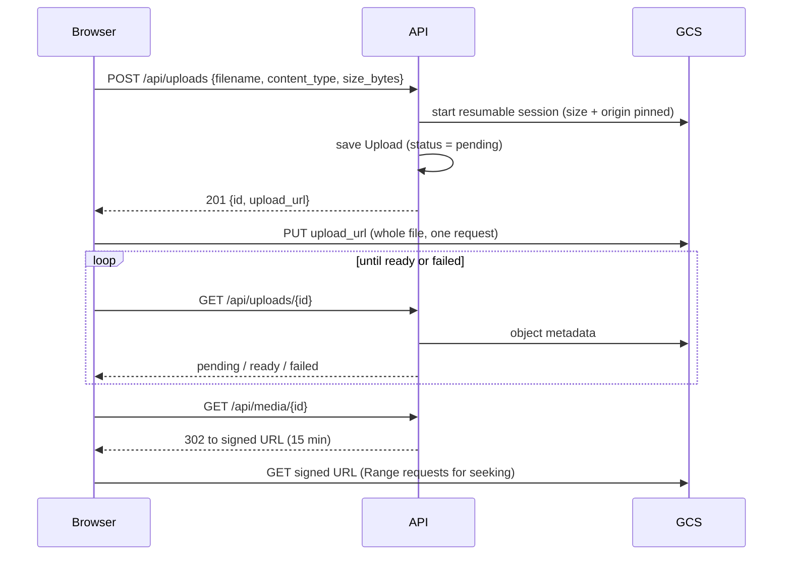

# gcs-video-upload-demo

Large video uploads straight from the browser to Google Cloud Storage, with
signed-URL playback and a reconciliation job that keeps the database and the
bucket in agreement. A small FastAPI service, written from scratch as a
reimplementation of a pattern I've used in production.

## The problem

Cloud Run rejects HTTP/1 request bodies over 32 MiB, and phone videos are often
gigabytes. Raising limits elsewhere doesn't help, and proxying the upload
through the API is the wrong fix anyway. Every byte would cross the API twice
(client to API, API to GCS). An instance would stay busy, and billed, for the
length of a slow mobile upload. A dropped connection would lose the whole
transfer, with no way to resume. GCS is built to take large uploads, so the API
should only hand out permission and record what happened. The bytes go directly
to the bucket.

## How it works



| Endpoint | Purpose |
|---|---|
| `POST /api/uploads` | Validate the request, open a resumable session, create a `pending` record, return the session URL. |
| `GET /api/uploads/{id}` | Status, for polling. A `pending` upload is checked against the bucket and moves to `ready` once the object exists with the expected size and content type. |
| `GET /api/media/{id}` | `302` to a short-lived V4 signed GET URL. |
| `GET /api/media/{id}?stream=1` | The API streams the object itself, with full Range support. |
| `python -m app.reconcile [--fix]` | Report on stuck uploads and orphaned objects; fix them with `--fix`. |

The code is in `app/`. `storage.py` is the only module that imports
`google-cloud-storage`. Everything else depends on the small `Storage` protocol,
which is why the tests can swap in an in-memory fake.

## Design decisions and tradeoffs

**Resumable session, not a signed upload URL.** A V4 signed `PUT` URL would
work too. A resumable session has two advantages. The API can pin the exact
byte count when it opens the session, so GCS rejects a body of any other size.
And the upload can be resumed after a dropped connection. The session URL is
itself the credential: anyone holding it can upload to that one object until
the upload completes or the session expires (about a week). That's why it's
only ever returned to the client that asked for it. The browser sends the file
in a single `PUT` and retries from the start on failure. Resuming from the last
byte GCS confirmed is listed under production work below.

**Polling for completion.** The browser could tell the API "I'm done", but that
is a claim, not evidence. Instead the status endpoint checks the bucket itself:
an upload becomes `ready` only once the object exists with the size and content
type that were declared. GCS Pub/Sub notifications would avoid polling. They
need more infrastructure, though, and a missed notification still needs a
backstop. Here the backstop is the reconciliation job.

**Signed URL expiry.** Playback URLs live for 15 minutes. That's long enough to
start a video, and short enough that a leaked link soon stops working. The
redirect is sent with `Cache-Control: no-store`, so no cache can hold on to it
after the URL inside has expired. Each request to `/api/media/{id}` signs a
fresh one.

**CORS on the bucket.** The browser talks to GCS directly, so CORS matters in
two places. For uploads, the API passes the app's origin when it opens the
session, and GCS answers the preflight for that session URL with that origin.
For downloads, a plain `<video src>` doesn't need CORS at all. Reading the bytes
from JavaScript (`fetch`, or drawing frames to a canvas) does, and needs a CORS
rule on the bucket:

```json
[{"origin": ["https://your-app.example"], "method": ["GET", "HEAD"],
  "responseHeader": ["Content-Type", "Range"], "maxAgeSeconds": 3600}]
```

**Redirect to a signed URL vs streaming through the API.** The default answer is
a `302`. GCS then serves the bytes, scales on its own, and handles Range
natively, and the API instance is free after a few milliseconds. `?stream=1`
streams through the API for cases where a redirect gets in the way. One example
is a `fetch()` that follows a same-origin request to another origin and loses
its CORS context. Streaming reads 1 MiB ranges from GCS and yields each one as
it arrives, so memory stays flat whatever the file size.

**Range support for video.** Seeking in a `<video>` element is a series of
`Range` requests. The streaming path parses a single range: `bytes=N-M`,
open-ended `bytes=N-`, and suffix `bytes=-N`. It answers `206 Partial Content`
with `Content-Range` and `Accept-Ranges: bytes`, or `416` with
`Content-Range: bytes */size` when the range starts past the end of the object.
A header it doesn't understand (another unit, several ranges) is ignored, and
the whole object is sent, as RFC 9110 allows.

**Why reconciliation exists.** The database and the bucket are two systems with
no transaction spanning them, so they drift. A browser closes mid-upload, and
the record stays `pending` with no object. A record is deleted, but the object
delete fails, and the object stays forever. `python -m app.reconcile` finds both
cases:

- `pending` uploads older than 24 hours whose object never arrived are marked
  `failed`. `ready` uploads are never touched.
- Objects under `uploads/` with no record and older than 24 hours are deleted.
  The age check protects uploads that are in progress right now.
- `failed` records are purged, with any object, after a grace period (7 days by
  default, `PURGE_GRACE_DAYS`). That leaves time to look into a failure before
  the evidence is gone.

By default it only reports; `--fix` applies the changes. **Safety stop:** if
more than 30% of the scanned objects have no record (once at least 25 have been
scanned), it changes nothing and exits non-zero. A bucket that is mostly
"orphans" almost always means the job is pointed at the wrong database or
bucket, and deleting everything would be the worst possible response. The
database is checked against the bucket 500 keys at a time, so memory doesn't
grow with the bucket.

## Running it locally

You need Docker. The stack runs [fake-gcs-server](https://github.com/fsouza/fake-gcs-server),
so no GCP account is required.

```bash
docker compose up --build
```

Open <http://localhost:8000>, pick a video, and it will upload, confirm and
play. Run the reconciliation report inside the container:

```bash
docker compose exec api python -m app.reconcile
```

Locally, the media redirect points at the emulator's plain download URL rather
than a signed one, because fake-gcs-server can't check V4 signatures. Against
real GCS it is a true V4 signed URL.

## Running the tests

```bash
uv sync
uv run pytest
```

The tests use an in-memory fake of the `Storage` protocol, so they need no
Docker and no network. CI also runs `ruff` and `mypy --strict`
(`.github/workflows/tests.yml`).

## Pointing it at real GCS

1. Create a bucket and apply the CORS rule above if you need JavaScript access
   to the bytes.
2. Give the service's identity `roles/storage.objectAdmin` on the bucket. To
   sign URLs without a key file, it also needs `roles/iam.serviceAccountTokenCreator`
   on itself. On Cloud Run, the default credentials hold only a token, so
   signing goes through the IAM `signBlob` API.
3. Leave `GCS_ENDPOINT` unset, and set:

| Variable | Example |
|---|---|
| `GCS_BUCKET` | `my-video-bucket` |
| `GCS_PROJECT` | `my-project` |
| `ALLOWED_ORIGIN` | `https://your-app.example` |
| `DATABASE_URL` | `sqlite:////data/uploads.db` |

Locally, `gcloud auth application-default login` (with impersonation of a
service account that can sign) is enough to try it.

## What I'd add for production

- **Auth.** Every endpoint is open. Uploads and media would be tied to a user,
  and every lookup scoped to its owner.
- **Resume interrupted uploads.** On failure, ask GCS how many bytes it has (a
  `PUT` with `Content-Range: bytes */size`) and continue from there, instead of
  starting over. This matters for multi-gigabyte files on mobile connections.
- **Rate limiting** on `POST /api/uploads`, since each call opens a session.
- **Lifecycle rules** on the bucket as a second line of defence. For example,
  delete objects under `uploads/` that were never confirmed, or move old videos
  to a colder storage class.
- **A real database** (Postgres) with migrations, and the reconciliation job on
  a scheduler (Cloud Scheduler calling a job) with alerting on its exit code.

## License

MIT
